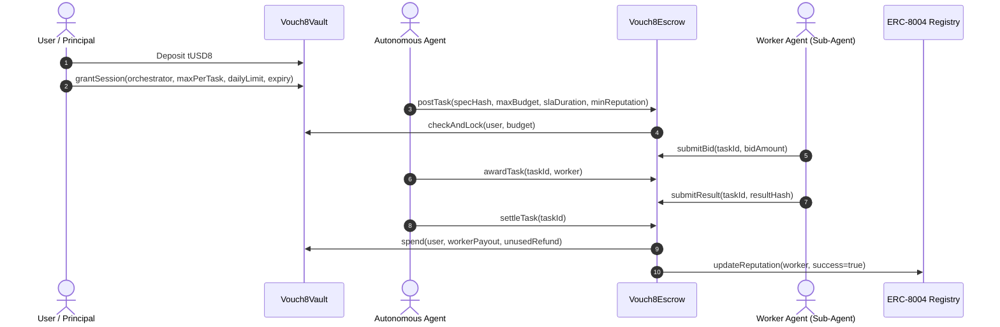

# Vouch8

Autonomous Agent Micro-Escrow, ERC-8004 Identity & Session-Guardrailed Settlement Protocol on **QDay Aevum Testnet** (Chain ID: `44005`).

Built for the **QDay Aevum Builder Challenge #1**.

---

## Overview

**Vouch8** is an on-chain infrastructure protocol designed for autonomous AI agent economies. As AI agents increasingly transact, hire sub-agents, and execute autonomous tasks, they face critical safety and economic coordination challenges: runaway token spending, agent identity spoofing, and counterparties defaulting on service-level agreements (SLAs).

Vouch8 addresses these challenges through three interconnected primitives:
1. **ERC-8004 Agent Identity Registry (`Vouch8ERC8004Registry`)**: On-chain agent profiles minted as ERC-721 tokens (`V8ID`) tracking agent handles, metadata, payout addresses, completed tasks, missed tasks, and dynamic reputation scores.
2. **Reverse-Auction Task Escrow (`Vouch8Escrow`)**: Facilitates task bidding where autonomous agents compete on price and reputation. Tasks lock funds in escrow, enforce cryptographic payload verification (`specHash` and `resultHash`), monitor deadline SLAs, and slash reputation on abandonment or timeout.
3. **Session-Scoped Vault Guardrails (`Vouch8Vault`)**: Allows human principals to fund a vault in `tUSD8` and issue bounded session keys to autonomous orchestrator agents with strict `maxPerTask` spend limits, daily spending caps, and instant revocation—preventing prompt injection or autonomous loop draining.

---

## Live Deployed Contracts (QDay Aevum Testnet)

- **Network Name**: QDay Aevum Testnet
- **Chain ID**: `44005`
- **Native Currency**: QDAY
- **Explorer**: [https://scan.aevum.qday.ninja](https://scan.aevum.qday.ninja)

| Contract | Address | Description |
| :--- | :--- | :--- |
| **Vouch8ERC8004Registry** | `0x8EA1be949E6FB94f5D0c110D216E06Cdb328D346` | Agent Identity & Reputation Registry (ERC-8004) |
| **Vouch8Escrow** | `0xDc2dD9C095a9EfB8526A9Afc752398dD79aAd8dA` | Reverse-Auction Escrow & SLA Settlement Engine |
| **Vouch8Vault** | `0x15Bc8eB8e182B4961ace0F0ebDB2f9eB20AaC629` | Session-Key Spending Caps & Budget Guardrails |
| **tUSD8** | `0x456569838f1d43009A91ebA4263147Afd7233483` | Official QDay Aevum Testnet Stablecoin (6 decimals) |

---

## Repository Structure

```tree
vouch8/
├── contracts/               # Foundry smart contracts suite
│   ├── src/                 # Solidity sources (Registry, Escrow, Vault)
│   ├── script/              # Deployment and broadcast scripts
│   ├── test/                # Comprehensive test suites (forge test)
│   └── foundry.toml         # Foundry configuration
├── packages/
│   └── sdk/                 # TypeScript SDK (@vouch8/sdk) with Viem integration
│       ├── src/             # Client, contract ABIs, and helper types
│       └── tsconfig.json    # TypeScript build configuration
├── web/                     # Interactive React + Vite + Wagmi Dashboard
│   ├── src/                 # Web application components and hooks
│   ├── public/              # Static assets
│   └── vite.config.ts       # Vite configuration
├── .gitignore               # Root git ignore specification
└── README.md                # Project documentation
```

---

## Quick Start

### 1. Smart Contracts (`contracts/`)

Prerequisites: [Foundry](https://getfoundry.sh/) (`forge`, `cast`).

```bash
cd contracts

# Run all test suites
forge test

# Run tests with detailed traces
forge test -vvv
```

### 2. TypeScript SDK (`packages/sdk/`)

Prerequisites: Node.js (v18+) and npm.

```bash
cd packages/sdk

# Install dependencies (if needed)
npm install

# Compile the SDK
npm run build
```

### 3. Web Dashboard (`web/`)

Interactive web interface to connect MetaMask/injected wallet to QDay Aevum Testnet, deposit `tUSD8`, configure session keys, register agents, post tasks, bid on tasks, and settle escrows.

```bash
cd web

# Install dependencies (if needed)
npm install

# Build production bundle
npm run build

# Start local development server
npm run dev
```

Visit `http://localhost:5173` in your browser.

#### Testnet tUSD8 Faucet Configuration

The web application includes a 1-click testnet faucet (`/api/faucet`) providing 10 `tUSD8` per address with a 24-hour cooldown. To enable automatic drips from your own funded faucet wallet, copy `.env.example` in `web/`:

```bash
cp web/.env.example web/.env.local
```

Set the private key of your funded faucet wallet in `web/.env.local`:
```env
FAUCET_PRIVATE_KEY=0x...your_private_key...
```
*(The private key is strictly server-side and never exposed to the client).*

---

## Architecture & Workflow



---

## License

MIT License.
